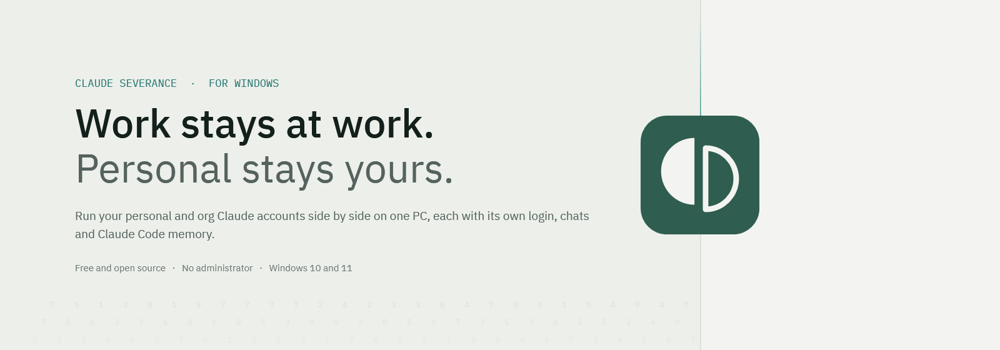
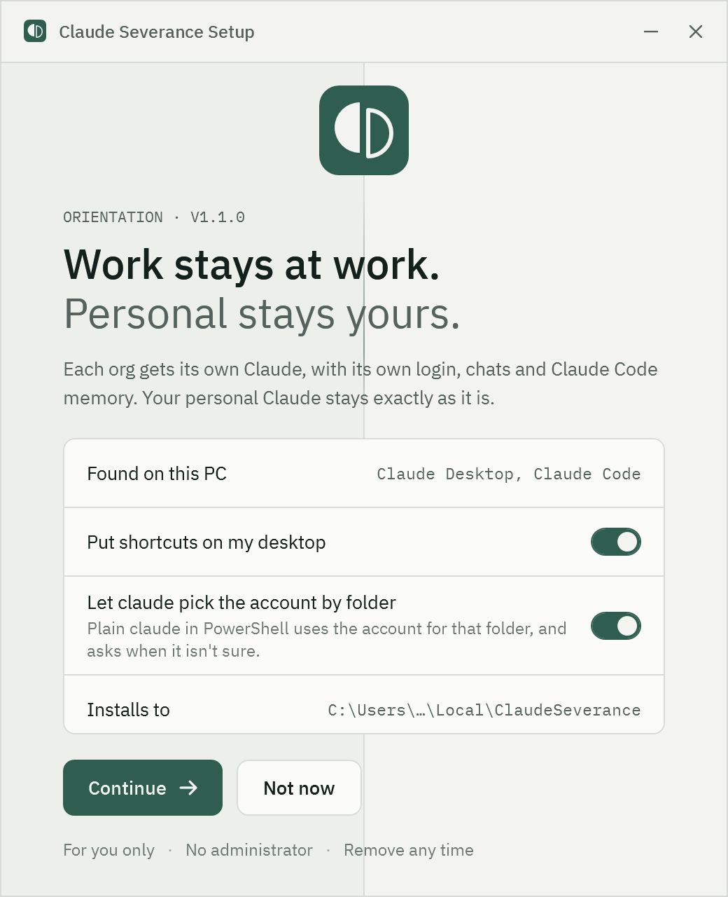
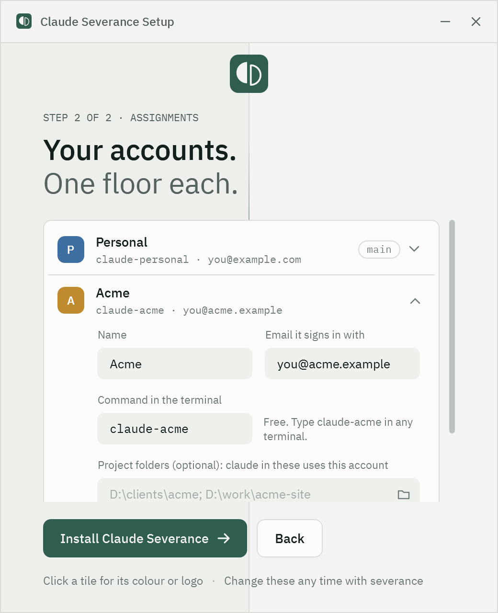
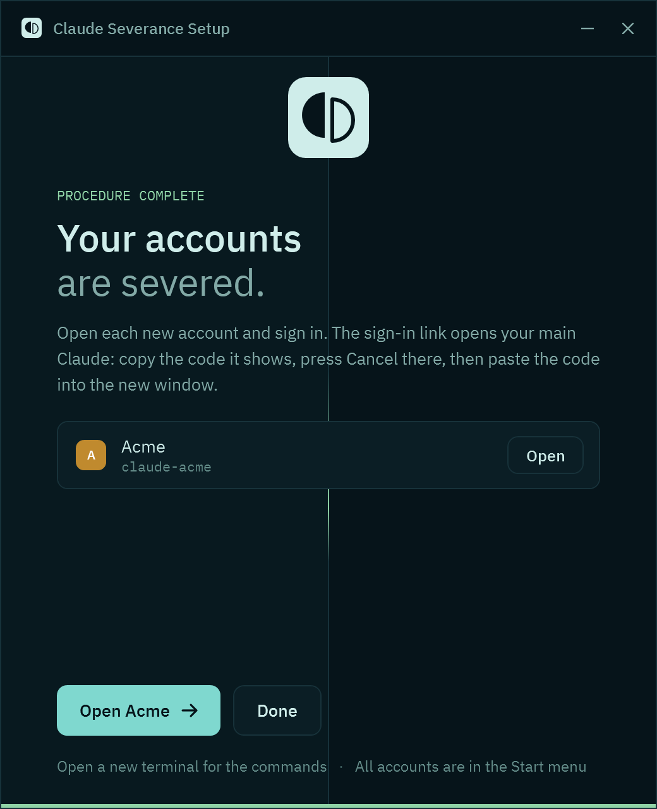
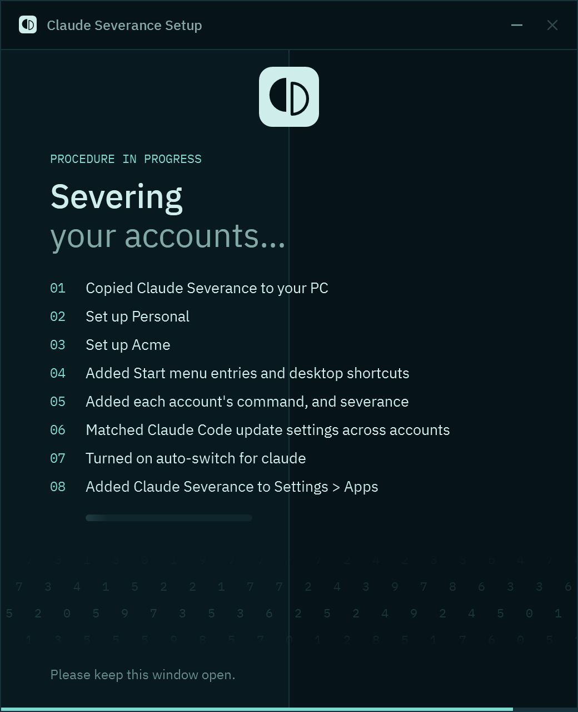
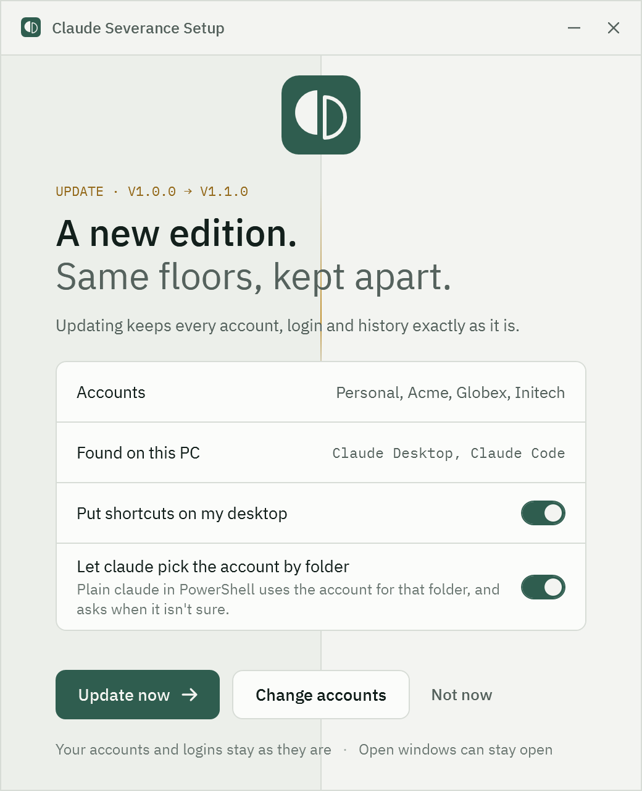
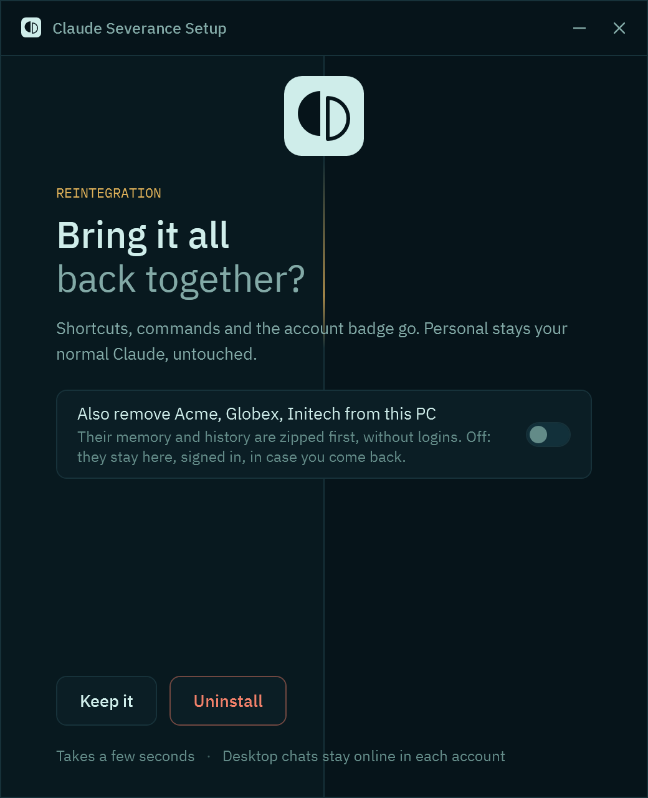
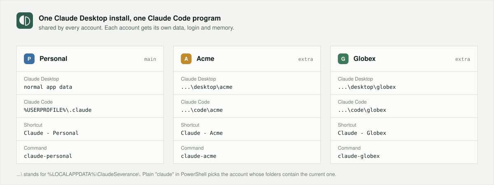

<p align="center">
  <picture>
    <source media="(prefers-color-scheme: dark)" srcset="assets/banner-dark.png">
    
  </picture>
</p>

<p align="center">
  <a href="https://github.com/fauzulkc/claude-severance/releases/latest"></a>
  
  
  <a href="#macos-and-linux-20-preview"></a>
  <a href="LICENSE"></a>
  <a href="https://github.com/fauzulkc/claude-severance/actions/workflows/ci.yml"></a>
</p>

**Claude Severance** runs your personal and org Claude accounts at the same time on one Windows PC. Your personal account stays your normal Claude. Each org account gets its own Claude Desktop window and its own `claude` command, with its own login, chats and Claude Code memory. **macOS and Linux** are in the [2.0 preview](#macos-and-linux-20-preview).

- **Signed in everywhere at once.** Every account runs in its own window, at the same time. Switching accounts never signs another one out.
- **Separate context.** Each account keeps its own Claude Code memory, `CLAUDE.md`, settings, MCP servers, skills and history.
- **As many orgs as you need.** Add one account per org. Each gets its own icon: your org's logo, or a coloured tile with its first letter.
- **Always know which account you're in.** A coloured badge with the signed-in email sits in Claude Code's status line and turns red on a wrong login.
- **Picks the account by folder.** Plain `claude` in `D:\clients\acme` uses the Acme account, and asks when a folder isn't mapped.
- **One-click install and uninstall.** It installs for you only, needs no administrator, and appears in Settings > Apps.

> **Not affiliated with Anthropic.** Claude Severance is an independent open-source tool. "Claude" is a trademark of Anthropic, PBC. Severance only launches the official Claude Desktop app and Claude Code CLI; it doesn't modify them.

## Screenshots

<p align="center">
  
  
  
</p>
<p align="center">
  
  
  
</p>

One seam splits the window into the work floor and the outside. The light running down it takes the colour of the step: grey-green while waiting, brass for a decision, teal while working, rust while removing, green when done. All screens, in both themes, are in [docs/screenshots](docs/screenshots).

## Install

1. Download **ClaudeSeverance-x.y.z.zip** from [Releases](https://github.com/fauzulkc/claude-severance/releases/latest) and extract it.
2. Double-click **Install.cmd**.
3. **Welcome:** setup checks for Claude Desktop and Claude Code, and offers to install either if it's missing.
4. **Accounts:** your main account is the Claude you already use. Add one account for each org. The email (used to catch wrong logins) and project folders (used to pick the account by folder) are optional.
5. **Ready:** open each new account and sign in once.

> **Signing in to a new account.** The browser sends the sign-in link to your *main* Claude. Copy the code it shows, press **Cancel** there, and paste the code into the new account's window. For Claude Code, run `claude-<account>` and type `/login`.

Requirements: Windows 10 or 11, Windows PowerShell 5.1 (built in), and [Claude Desktop](https://claude.ai/download). Setup can install Claude Desktop (through winget) and [Claude Code](https://docs.claude.com/en/docs/claude-code/setup) for you.

## macOS and Linux (2.0 preview)

Version 2.0 is a rewrite in Rust that runs on Windows, macOS and Linux. It's a **preview**: every part of it is tested on fresh GitHub macOS and Linux machines on each change, but it hasn't been used on a real Mac or Linux desktop yet, signing in included. Please [open an issue](https://github.com/fauzulkc/claude-severance/issues) with what works and what doesn't.

1. Download the archive for your system from the [2.0 preview release](https://github.com/fauzulkc/claude-severance/releases/tag/v2.0.0-preview.1): `macos-universal` (Apple silicon and Intel), `linux-x86_64` or `linux-aarch64`.
2. Extract it and install from a terminal:

   ```bash
   tar -xzf ClaudeSeverance-2.0.0-preview.1-*.tar.gz
   cd ClaudeSeverance-2.0.0-preview.1-*/
   xattr -dr com.apple.quarantine .     # macOS only: the preview isn't signed yet
   ./severance install
   ```

3. Open a new terminal, then add an account per org: `severance add Acme --email you@acme.com --folder ~/clients/acme`, or open the manager window with `severance setup`.

| | macOS | Linux |
|---|---|---|
| Launchers | `.app` launchers in `~/Applications/Claude Severance` and on the desktop | `.desktop` launchers in the app menu and on the desktop |
| Claude Desktop | `Claude.app`, each account with its own data folder | A `claude-desktop` program on your PATH, if there is one. Without it, accounts get terminal launchers only. |
| Terminal | Terminal.app | `$TERMINAL`, else the first terminal found (GNOME Terminal, Konsole, kitty, Alacritty, xterm and others) |
| Commands and auto-switch | `~/.zshrc` (and `~/.bashrc` if you have one) | `~/.bashrc` (and `~/.zshrc` if you have one) |
| Install folder | `~/Library/Application Support/Claude Severance` | `~/.local/share/claude-severance` |

Not yet: signed and notarised macOS builds, installers (`.dmg`, AppImage, `.deb`), Homebrew, and the fish shell. Windows users can try the preview too, but 1.1 above is the stable version.

## Everyday use

| | |
|---|---|
| **Claude Desktop** | Open a **Claude - &lt;name&gt;** shortcut from the desktop or the Start menu. Windows for different accounts run side by side. |
| **Claude Code** | Each account has its own command, `claude-<account>` unless you rename it, and it works in any terminal. Plain `claude` in PowerShell picks the account from the folder you're in. |
| **Who am I signed in as?** | Run `severance` to list each account, its command and its signed-in email. In Claude Code, check the status line badge. In Desktop, the account menu is at the bottom left, and you can give each account its own theme. |
| **Add or remove accounts** | Any time, as many as you need: Start > Claude Severance > **Manage accounts**, Settings > Apps > **Modify**, `severance setup`, or the commands below. Removed accounts are zipped first, without their logins. |
| **Repair** | `severance repair` reinstalls quietly with your current accounts. |

```powershell
severance list                                       # every account, its command, who it's signed in as
severance add Globex --email you@globex.com --folder D:\clients\globex
severance alias globex gx                            # rename Globex's command to gx
severance remove globex                              # zip it (without its login), then remove it
```

Before any command name is used, setup checks that nothing else on the PC already has it: Windows and cmd built-ins, `claude` itself, your other accounts, and every program, script, function and alias PowerShell can find. If the name is taken, it says by what and asks for another.

<p align="center"></p>

## How it works

| | Main account | Each extra account |
|---|---|---|
| Claude Desktop | Your normal app and its data, started as usual | The same app, started with its own data folder (`--user-data-dir`), so it has its own login and runs alongside |
| Claude Code | Your normal `%USERPROFILE%\.claude` | Its own `CLAUDE_CONFIG_DIR`, so it has its own login, memory, settings and history |
| Shortcut and command | **Claude - Personal**, `claude-personal` | **Claude - Acme**, `claude-acme` |

Everything Claude Severance adds lives in `%LOCALAPPDATA%\ClaudeSeverance`. More detail is in [docs/ARCHITECTURE.md](docs/ARCHITECTURE.md).

## Update and uninstall

- **Update:** run a newer **Install.cmd**. The update screen keeps your accounts, logins and history exactly as they are.
- **Uninstall:** use **Uninstall.cmd**, Start > Uninstall Claude Severance, or Settings > Apps.
  - It removes the shortcuts, commands, account badge, auto-switch and the Settings > Apps entry. Your main Claude is untouched.
  - The extra accounts stay on the PC, signed in, so reinstalling brings them back.
  - Turn on **Also remove … from this PC** to zip their memory and history to `%USERPROFILE%\Claude Severance backups` and delete them. Login tokens are never included in the zip.

## Updating Claude itself

- **Claude Desktop** is one install shared by every account. Update from your main window. In extra windows, close them and reopen from their shortcuts, rather than using "Restart to update".
- **Claude Code** is one program shared by every account. Setup keeps the update channel the same in every account so they never trade versions.

## FAQ

**Is using several accounts allowed?** Holding separate accounts for separate purposes, such as personal and work, is fine. Sharing or reselling accounts, or using a second account to get around a ban or usage limits, is not. Follow each organization's rules for its account, and keep client work on that client's account.

**Where are my logins stored?** In the same places the official apps keep them: each account's Claude Desktop data folder and its Claude Code `.credentials.json`. Claude Severance never reads, copies or sends them. Backups leave them out.

**Does it touch the network?** Only when you ask setup to install Claude Desktop (winget) or Claude Code (Anthropic's official installer).

**Can I use it in cmd.exe or Git Bash?** Yes, `claude-<account>` works in any terminal. The auto-switching plain `claude` is PowerShell only.

**The setup window doesn't open.** Run `Install.cmd /text` for the same setup as questions in a console. Errors are logged to `%TEMP%\claude-severance-setup.log`.

## Known limits

- Extra Desktop windows rely on Electron's `--user-data-dir` flag, which Anthropic doesn't officially support for Claude Desktop. Your main account doesn't depend on it.
- In extra windows, Cowork runs in local mode, and Google sign-in finishes in the main window (use the code flow above).
- Git, SSH and cloud CLI logins are shared by every account.
- A repo's own `.claude\`, `CLAUDE.md` and `.mcp.json` apply to whichever account opens it.
- For complete separation (separate Windows credentials, files and browser), use a separate Windows user per organization.

## Development

```powershell
Preview.cmd install dark accounts                  # open any screen with sample accounts; changes nothing
powershell -File tools\capture-screens.ps1         # render every screen, light and dark, to docs\screenshots
powershell -File tools\build-release.ps1           # build dist\ClaudeSeverance-<version>.zip
powershell -STA -File tools\make-graphics.ps1      # rebuild the logo, app icon and banners
Invoke-Pester -Path tests                          # unit tests (Pester 5)
```

**2.0 (Rust, preview)** lives in `crates/` and `app/`. It builds with the toolchain pinned in `rust-toolchain.toml`:

```bash
cargo test --workspace                                  # unit tests and a sandboxed 1.x-to-2.0 update
cargo clippy --workspace --all-targets -- -D warnings
cargo run -p severance-cli -- --sandbox target/sandbox install   # try any command without touching this PC
cargo run -p severance-app -- --preview                          # the manager window, on sample accounts
```

See [CONTRIBUTING.md](CONTRIBUTING.md), the setup window's design notes in [docs/DESIGN.md](docs/DESIGN.md), and [RELEASING.md](RELEASING.md).

**Version 2.0 is a rewrite in Rust** for Windows, macOS and Linux from one codebase, with the same accounts file, so a 1.x install updates in place. It ships as previews first; 1.x stays supported until 2.0 is stable. On Linux and macOS, `tools/e2e-unix.sh` installs it for real in a throwaway home folder and checks every launcher, shell profile and command. iOS isn't possible (an iOS app can't start other apps with their own data). See [docs/PLATFORMS-PLAN.md](docs/PLATFORMS-PLAN.md).

## License

[MIT](LICENSE). The bundled fonts, IBM Plex Sans and IBM Plex Mono, are under the [SIL Open Font License](src/fonts/OFL-IBMPlex.txt).
